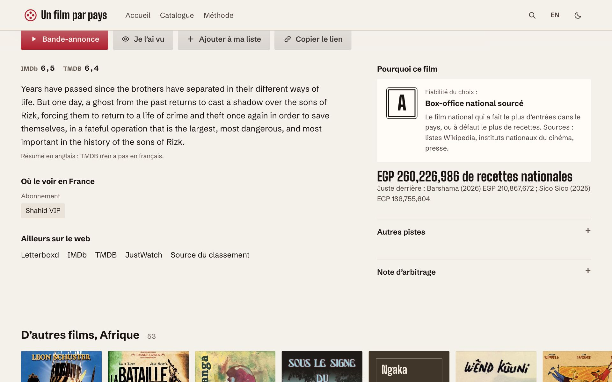

# One film per country: the most-watched movie from every country in the world

**Open the site: [onefilmpercountry.morain.fr](https://onefilmpercountry.morain.fr/)**

A world cinema list with one film from every country: the national film most people actually went to see at home, in its original language. 199 countries and territories, 196 films, an interactive world map, IMDb, TMDB and Rotten Tomatoes ratings, trailers. Built for a simple ritual: one movie night per country.

Most "a film from every country" lists rank by rating or critical reputation. This one ranks by national audience (box office) when the data exists, and says how reliable each pick is instead of pretending they are all equal.

*Version française plus bas : un film par pays, le cinéma du monde en 196 films.*


| World map | Film page |
|---|---|
|  |  |
| **Catalogue, filter and sort** | **Light theme** |
|  |  |

<p align="center"></p>

## How the films were chosen

A film counts for a country if its production and creative team come from there, if it is in a language spoken there, and if it is fiction (animation allowed, documentaries excluded). A film is used only once.

| Level | Countries | Rule |
|---|---|---|
| A | 82 | Sourced box office: the national film with the most admissions in the country, or failing that the highest national gross. Worldwide gross does not count. |
| B | 24 | No published box office: the country's most-rated film on TMDB (50 votes minimum), produced mainly by that country. |
| C | 61 | Too little data: the first "native voice" pick of [Films Around the World](https://filmsaroundthe.world/methodology/). |
| D | 29 | Last resort: the country's most-rated film on TMDB, under 50 votes. |
| none | 3 | No fiction film found. |

Known limits:

- Records span eras. Poland and the UK have 1950s records counted in admissions, other countries recent records counted in revenue.
- Twenty level A picks were checked independently. 18 hold, Germany and Italy were corrected.
- Every manual call is written down with its reason in [`data/overrides.json`](data/overrides.json) (in French).
- Where popular cinema lives on YouTube rather than in theatres (Somalia, Nollywood, Ethiopia), the data notes the video phenomenon when known.

Full method: [`docs/methode.md`](docs/methode.md) (in French).

**Found a mistake or a better candidate?** Open an issue with the country, the film and a source (box office list, national film institute, press). Sourced corrections are welcome.

## The site

- A film of the day up top, then the world map: click a country to open its film, or draw one at random.
- Each film has its own page (`/film/<country code>/`, shareable): poster, original and translated title, IMDb, TMDB and Rotten Tomatoes ratings, trailer, where to watch it in France (via JustWatch), links to Letterboxd, TMDB, IMDb and the ranking source, and a stamp saying how reliable the pick is (A to D) and why.
- Rows by theme (top rated, streaming in France, under 90 minutes, animation, by continent), and a catalogue you can filter by continent, decade, length, language and reliability, then sort.
- "I've watched it" turns the country red, "My list" keeps films for later. Both stay in your browser (localStorage), no account, nothing sent anywhere.
- French and English, light and dark themes.

Built with [Astro](https://astro.build/) and Tailwind CSS in `web/`, static output, deployed on Vercel from `main`. The old GitHub Pages address redirects there (`redirect/`). d3 loads only when the map comes into view. Fonts (Big Shoulders Display, Schibsted Grotesk) are self-hosted.

```bash
cd web
npm install
npm run dev     # local site
npm test        # unit tests (vitest)
npm run build   # static site in web/dist
```

## Rebuilding the data

Requires a free [TMDB API key](https://www.themoviedb.org/settings/api) in a `.env` file at the root: `TMDB_API_KEY=...`

```bash
python3 scripts/tmdb_tier_b.py      # level B: most-rated national films per country (TMDB)
python3 scripts/build.py            # picks one film per country, A > B > C > D, applies overrides
python3 scripts/enrich_ratings.py   # IMDb, TMDB, Rotten Tomatoes ratings and trailers, into data/ratings.json
python3 scripts/export_site.py      # writes web/src/data/films.json
python3 scripts/export_xlsx.py      # writes films-du-monde.xlsx (needs openpyxl)
```

`enrich_ratings.py` reads the ratings through the movie lookup of a [Radarr](https://radarr.video/) instance (`RADARR_URL` and `RADARR_API_KEY` in `.env`), which returns IMDb, TMDB and Rotten Tomatoes scores in one call. Without one, keep the committed `data/ratings.json`.

Level A box office research lives in `data/raw/tierA_*.json` (first pass) and `data/raw/tierA2_*.json` (second pass, takes priority), following [`docs/spec-niveau-A.md`](docs/spec-niveau-A.md).

## Credits and licenses

- Code: [MIT](LICENSE).
- The curated list (which film for which country, levels, notes): [CC BY 4.0](https://creativecommons.org/licenses/by/4.0/).
- Film data and posters come from [TMDB](https://www.themoviedb.org/). This product uses the TMDB API but is not endorsed or certified by TMDB. Two posters missing from TMDB (Grenada, Marshall Islands) come from [Films Around the World](https://filmsaroundthe.world/) and are credited on their ticket. Films with no poster anywhere get a typographic one drawn by the site. Posters belong to their rights holders.
- Streaming availability: JustWatch, via TMDB.
- Editorial picks for level C: [Films Around the World](https://filmsaroundthe.world/).
- Box office figures: Wikipedia lists, national film institutes and press, linked one by one in the data.
- Countries and languages: [mledoze/countries](https://github.com/mledoze/countries) (ODbL). Map: [Natural Earth](https://www.naturalearthdata.com/) via [world-atlas](https://github.com/topojson/world-atlas).
- Inspired by [BestFilmsByCountry](https://github.com/EkulRF/BestFilmsByCountry).

---

## Version française : un film par pays

**Le site : [onefilmpercountry.morain.fr](https://onefilmpercountry.morain.fr/)**

Le cinéma du monde en un film par pays : le film national le plus vu dans chaque pays, en version originale. Une carte du monde interactive, 199 pays et territoires, 196 films, les notes IMDb, TMDB et Rotten Tomatoes, la bande-annonce et où le voir en France. De quoi tenir une soirée ciné par pays.

Les autres listes « un film par pays » classent à la note ou à la réputation. Celle-ci classe à l'audience nationale quand la donnée existe, et affiche la fiabilité de chaque choix : A (box-office sourcé), B (le plus noté sur TMDB), C (choix éditorial de Films Around the World), D (dernier recours). La méthode complète est dans [`docs/methode.md`](docs/methode.md), les arbitrages manuels dans [`data/overrides.json`](data/overrides.json), et le tableur dans [`films-du-monde.xlsx`](films-du-monde.xlsx).

Une erreur ou un meilleur candidat ? Ouvrez une issue avec le pays, le film et une source.
