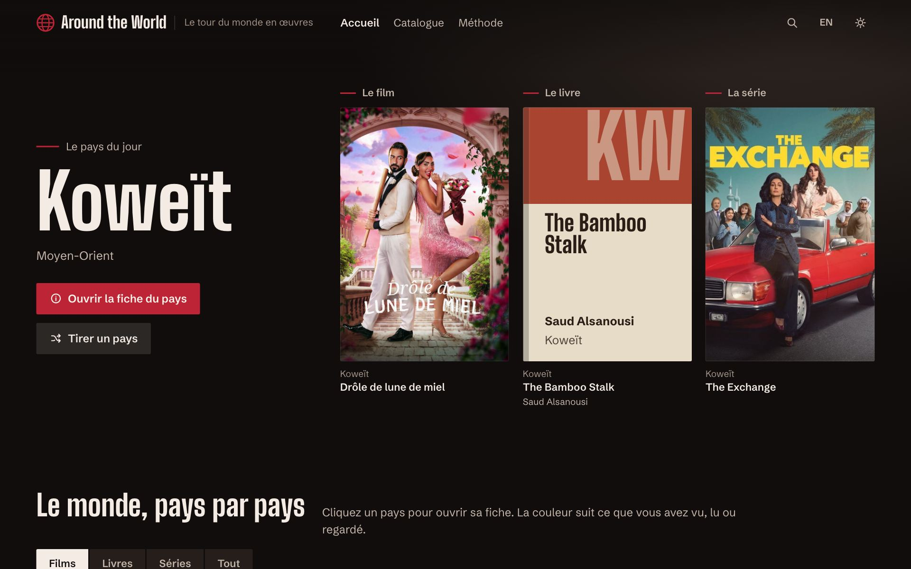
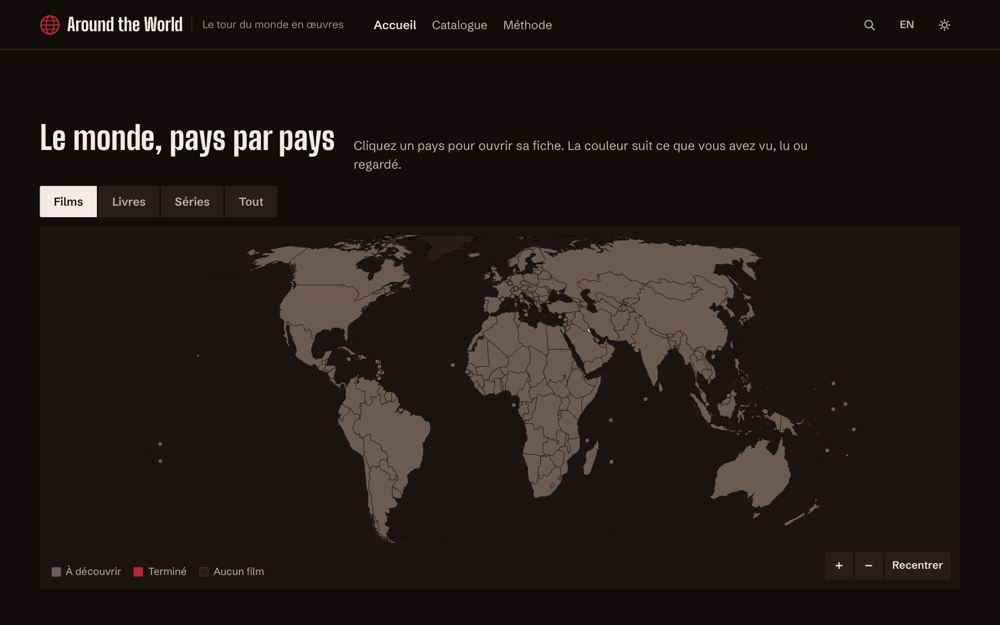
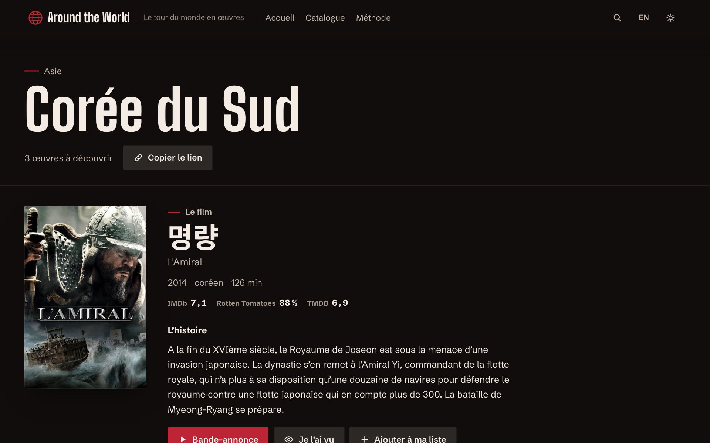
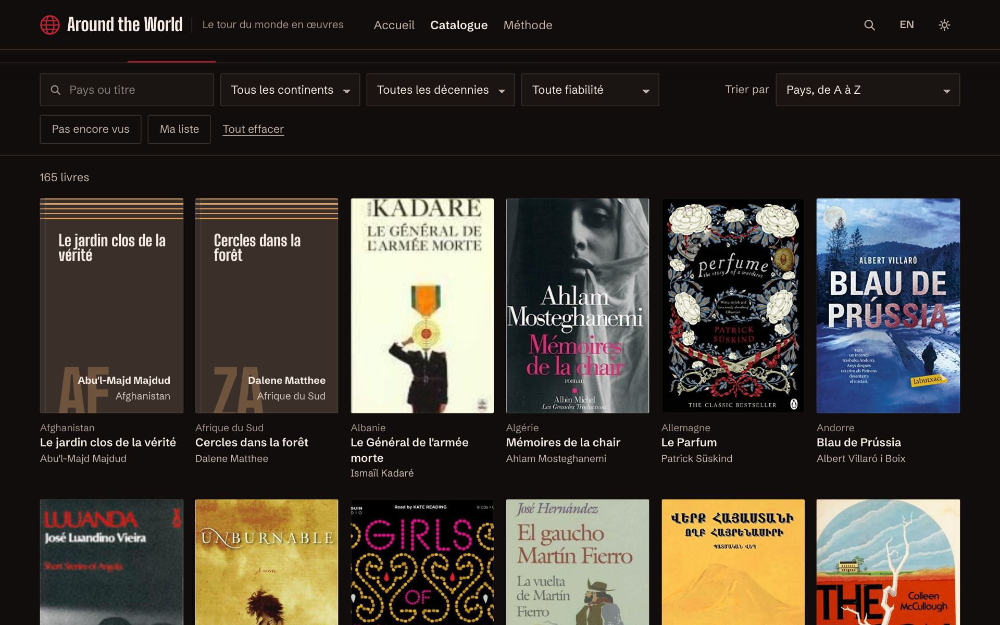
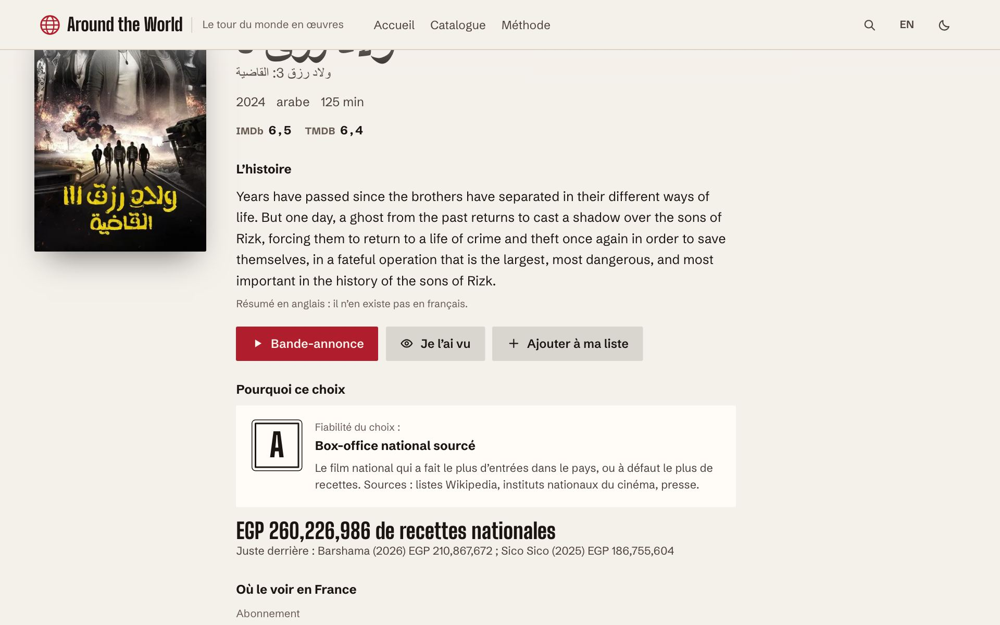
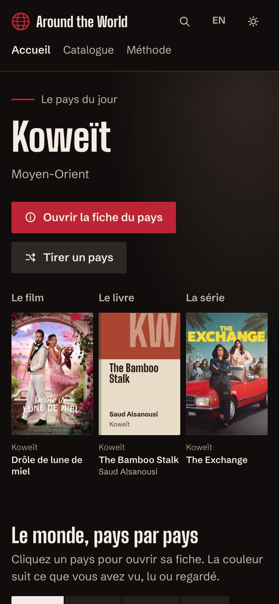

# Around the World: a film, a book and a TV series from every country

**Open the site: [aroundtheworld.morain.fr](https://aroundtheworld.morain.fr/)**

A tour of world culture, one country at a time. For each of 199 countries and territories, three works side by side: the national film most people went to see at home, the national book most read, and the national TV series most watched, each in its original language. An interactive world map, IMDb, TMDB and Rotten Tomatoes ratings, trailers, book covers, synopses.

Most "one per country" lists rank by rating or critical reputation. This one ranks by national audience (box office, sales, TV ratings) when the data exists, and gives every pick a reliability level instead of pretending they are all equal.

*Version française plus bas : le tour du monde en œuvres.*



| World map | Country page |
|---|---|
|  |  |
| **Catalogue, filter and sort** | **Light theme** |
|  |  |

<p align="center"></p>

## How the works were chosen

A work counts for a country if it was made there (author from the country, or production and creative team from there), in a language spoken there. Writing or filming in English for export does not count, except in English-speaking countries.

### Films (196)

| Level | Countries | Rule |
|---|---|---|
| A | 82 | Sourced box office: the national film with the most admissions in the country, or failing that the highest national gross. Worldwide gross does not count. |
| B | 24 | No published box office: the country's most-rated film on TMDB (50 votes minimum). |
| C | 61 | Too little data: the first "native voice" pick of [Films Around the World](https://filmsaroundthe.world/methodology/). |
| D | 29 | Last resort: the country's most-rated film on TMDB, under 50 votes. |

Fiction only, animation allowed, documentaries excluded. A film is used only once.

### Books (165) and series (93)

| Level | Books | Series | Rule |
|---|---|---|---|
| A | 32 | 42 | Sourced: national sales, a national reading poll or a set text of the school curriculum for books; a measured audience record (Nielsen, BARB, Médiamétrie, Kantar…) for series. |
| B | 57 | 27 | Strong signal: a sourced pick that rests only on a worldwide figure, a mention without a figure or a single season, or an automatic pick with a strong signal (10+ Wikipedia articles for a book, 50+ TMDB votes for a series). |
| C | 76 | 24 | Automatic pick with a weak signal. |

Automatic picks: the literary work by an author of the country with the most Wikipedia articles (Wikidata, religious and political texts excluded), and the country's most-voted series on TMDB. 34 countries have no book and 106 no series yet, mostly small states.

Every manual call is written down with its reason, in French: [`data/overrides.json`](data/overrides.json) for films, [`data/overrides_livres_series.json`](data/overrides_livres_series.json) for books and series. Full method: [`docs/methode.md`](docs/methode.md) (in French).

**Found a mistake or a better candidate?** Open an issue with the country, the work and a source (box office list, sales figures, ratings, press). Sourced corrections are welcome.

## The site

- A country of the day up top, with its film, book and series, then the world map: click a country to open it, or draw one at random.
- Each country has its own page (`/pays/<code>/`, `/en/country/<code>/`): for each work, the image, original and translated title, synopsis, a stamp saying how reliable the pick is (A to D) and why, the source and links. Films also get ratings, trailer and where to watch in France (via JustWatch).
- A catalogue with three tabs (films, books, series) you can filter by continent, decade and reliability, then sort.
- "Seen" and "My list" for every work. The map colours countries by what you have seen, read or watched. Everything stays in your browser (localStorage), no account, nothing sent anywhere.
- French and English, light and dark themes.

Built with [Astro](https://astro.build/) and Tailwind CSS in `web/`, static output, deployed on Vercel from `main`. The old addresses (onefilmpercountry.morain.fr, the GitHub Pages site) redirect there. Fonts (Big Shoulders Display, Schibsted Grotesk) are self-hosted.

```bash
cd web
npm install
npm run dev     # local site
npm test        # unit tests (vitest)
npm run build   # static site in web/dist
```

## Rebuilding the data

Requires a free [TMDB API key](https://www.themoviedb.org/settings/api) in a `.env` file at the root: `TMDB_API_KEY=...`

```bash
python3 scripts/tmdb_tier_b.py      # films, level B: most-rated national films per country (TMDB)
python3 scripts/build.py            # one film per country, A > B > C > D, applies overrides
python3 scripts/enrich_ratings.py   # IMDb, TMDB, Rotten Tomatoes ratings and trailers, into data/ratings.json
python3 scripts/books_series.py     # books and series: research > overrides > automatic picks (Wikidata via QLever, TMDB)
python3 scripts/book_covers.py      # book covers from Open Library, into web/public/covers/
python3 scripts/export_site.py      # writes web/src/data/films.json
python3 scripts/export_xlsx.py      # writes films-du-monde.xlsx (needs openpyxl)
```

`enrich_ratings.py` reads the ratings through the movie lookup of a [Radarr](https://radarr.video/) instance (`RADARR_URL` and `RADARR_API_KEY` in `.env`). Without one, keep the committed `data/ratings.json`.

Sourced research lives in `data/raw/`: `tierA_*.json` and `tierA2_*.json` for films ([`docs/spec-niveau-A.md`](docs/spec-niveau-A.md)), `bsA_*.json` for books and series ([`docs/spec-livres-series.md`](docs/spec-livres-series.md)).

## Credits and licenses

- Code: [MIT](LICENSE).
- The curated list (which work for which country, levels, notes): [CC BY 4.0](https://creativecommons.org/licenses/by/4.0/).
- Film and series data and posters come from [TMDB](https://www.themoviedb.org/). This product uses the TMDB API but is not endorsed or certified by TMDB. Posters belong to their rights holders.
- Book data: [Wikidata](https://www.wikidata.org/). Book synopses are extracts from Wikipedia ([CC BY-SA](https://creativecommons.org/licenses/by-sa/4.0/)), credited on each page. Covers: [Open Library](https://openlibrary.org/). Works with no image get a typographic cover drawn by the site.
- Streaming availability: JustWatch, via TMDB.
- Editorial film picks for level C, and two posters missing from TMDB: [Films Around the World](https://filmsaroundthe.world/).
- Box office, sales and ratings figures: Wikipedia, national institutes and press, linked one by one in the data.
- Countries and languages: [mledoze/countries](https://github.com/mledoze/countries) (ODbL). Map: [Natural Earth](https://www.naturalearthdata.com/) via [world-atlas](https://github.com/topojson/world-atlas).
- Inspired by [BestFilmsByCountry](https://github.com/EkulRF/BestFilmsByCountry).

---

## Version française : le tour du monde en œuvres

**Le site : [aroundtheworld.morain.fr](https://aroundtheworld.morain.fr/)**

Un film, un livre et une série par pays : le film national le plus vu en salle dans le pays, le livre le plus lu et la série la plus regardée, en version originale. 199 pays et territoires, une carte du monde interactive, les notes des films, les bandes-annonces, les couvertures et les résumés.

Les autres listes « un par pays » classent à la note ou à la réputation. Celle-ci classe à l'audience nationale quand la donnée existe (entrées, ventes, audiences télé), et affiche la fiabilité de chaque choix, de A (source chiffrée) à C ou D (choix par défaut). La méthode complète est dans [`docs/methode.md`](docs/methode.md), les arbitrages manuels dans [`data/overrides.json`](data/overrides.json) et [`data/overrides_livres_series.json`](data/overrides_livres_series.json).

Une erreur ou un meilleur candidat ? Ouvrez une issue avec le pays, l'œuvre et une source.
